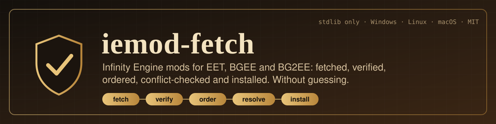

<p align="center">
  
</p>

<p align="center">
  <a href="https://github.com/gsamuele78/iemod-fetch/actions/workflows/ci.yml"></a>
  <a href="https://github.com/gsamuele78/iemod-fetch/actions/workflows/security.yml"></a>
  <a href="https://www.python.org/downloads/"></a>
  <a href="LICENSE"></a>
  <a href="docs/ARCHITECTURE.md"></a>
  
  
</p>

<p align="center">
  <b><a href="#from-weidu-logs-to-a-running-eet-game">Quick start</a></b> ·
  <a href="docs/GUIDE.md">User guide</a> ·
  <a href="#what-it-guarantees">Guarantees</a> ·
  <a href="docs/ADR.md">Design decisions</a> ·
  <a href="CHANGELOG.md">Changelog</a> ·
  <a href="docs/ROADMAP.md">Roadmap</a>
</p>

# iemod-fetch

Turns two `WeiDU.log` files (what you want installed) and a `mod_downloads.json`
catalogue (where to get it) into a **running EET, BGEE or BG2EE install**. It
downloads and verifies every mod, plans a rule-compliant install order, removes
the components the community rule sets say must go, and writes one script that
installs everything with WeiDU on Windows or Linux. It never guesses: whatever
the evidence does not decide is reported to you, with the reason.

Standard library only at runtime. One file, no dependencies.

**Current release: 2.4.0** - component names as WeiDU prints them, update
notices, conflicts with options you choose (`--decisions`), BIO share codes and
Project Infinity lists in, and engine limits measured in your game folder. What
changed in each release is in [`CHANGELOG.md`](CHANGELOG.md).

| Step | What happens | Flag |
|---|---|---|
| **Share** | reads and writes BIO share codes (`BIO-MODLIST-V1:`), keeping every field BIO put in them | `--bio-code` `--emit-bio-code` |
| **Import** | reads a Project Infinity / Infinity Mod Forge list (`LABEL;description`), each LABEL resolved from the mods' own tp2s | `--pi-list list.txt:EET` |
| **Choose** | every mod lcc-docs, BWS-NG and krion64 know, with games, status, quality and the newest version any of them names; with a WeiDU.log, which installed mods have an update | `--list-mods PATH` |
| **Name** | each staged mod's components named exactly as WeiDU names them, in your language, from its tp2 and `.tra` files | `--describe-mods PATH` |
| **Fetch** | resolves each mod from its catalogue entry, GitHub release or trusted owner; refuses an HTML page served as an archive | *(default)* |
| **Verify** | magic bytes, size and ratio limits, path-traversal checks, the mod's own `.tp2`, pinned `sha256` | *(always)* |
| **Order** | sorts every component against the BWS-NG and krion64 rule data, then re-checks the result | `--plan-order DIR` |
| **Order** at component level | splits a mod across the install where krion64 or a component rule places its parts apart | *(with `--plan-order`)* |
| **Resolve** | removes the components an error-graded incompatibility rule pins, and the earlier of two options of one WeiDU subcomponent group; lists the rest for you | `--resolve-conflicts` |
| **Limits** | kits (256), spell states and spell ids per level (50), per install, against the limits WeiDU and the engine actually have - measured in the game folder when the log is in one, else estimated from krion64; warnings, never a block | *(with the conflict report)* |
| **Decide** | every conflict comes with its options (drop a side, reorder, install what is missing) and their cost; your choice, by option id, is applied to the plan and re-checked | `--decisions decisions.json` |
| **Simulate** | walks the plan as WeiDU will: each mod's own tp2 REQUIRE/FORBID/GAME_IS, the game turning into EET, EET's merge allow-list; lists every refusal | `--simulate` |
| **Game folders** | identifies BG:EE / BG2:EE / EET the way WeiDU does; refuses a modded BG2:EE, missing SoD, swapped folders | `--bgee-dir` `--bg2ee-dir` |
| **Language** | each mod in the first of your languages it offers, read from its own tp2 | `--language-preference it_IT,en_US` |
| **Install** | `install-eet.sh` / `.cmd`: hands both logs to [mod_installer](https://github.com/dark0dave/mod_installer) + WeiDU, BGEE first, then EET | `--emit-installer` |

## Contents

- [From WeiDU logs to a running EET game](#from-weidu-logs-to-a-running-eet-game)
- [Install](#install) · [The wizard (GUI)](#the-wizard-gui)
- [Checking the install](#checking-the-install)
- [Making it reproducible](#making-it-reproducible)
- [Supplementary catalogues](#supplementary-catalogues)
- [Community data, kept current](#community-data-kept-current)
- [Sharing a list with BIO](#sharing-a-list-with-bio)
- [Lists from Project Infinity and Infinity Mod Forge](#lists-from-project-infinity-and-infinity-mod-forge)
- [Choosing mods: names and updates](#choosing-mods-names-and-updates)
- [Planning the install order](#planning-the-install-order)
- [What it guarantees](#what-it-guarantees) · [What it deliberately does not do](#what-it-deliberately-does-not-do)
- [Development](#development) · [Documentation](#documentation)

## From WeiDU logs to a running EET game

```bash
# 0. nothing to clone: lcc-docs, BigWorldSetup-NG and krion64 are fetched into a
#    cache and kept current automatically when a run starts (ADR-0032)

# 1. fetch and verify every mod the logs name
python3 -m iemod_fetch -m mod_downloads.json \
    -w WeiDU.log:EET -w WeiDUBGEE.log:BGEE -t ./Mods

# 2. plan the order, resolve what the rules decide, write the installer
python3 -m iemod_fetch --check-only -m mod_downloads.json \
    -w WeiDU.log:EET -w WeiDUBGEE.log:BGEE -t ./Mods \
    --plan-order ./plan --resolve-conflicts --simulate --emit-installer \
    --bgee-dir ~/games/BGEE --bg2ee-dir ~/games/EET \
    --language-preference it_IT,en_US          # optional: Italian, else English

# 3. install onto CLEAN copies of both games (needs WeiDU + mod_installer)
BGEE_DIR=~/games/BGEE BG2EE_DIR=~/games/EET sh ./plan/install-eet.sh
#   Windows:  set BGEE_DIR=... & set BG2EE_DIR=... & plan\install-eet.cmd
```

Step 3 refuses a folder that is not a game, a game that already has mods, and
(on Linux) mixed-case mod folders, before anything runs. `DRY_RUN=1` prints the
command instead of running it. One game only? Pass one log and run
`install.sh` / `install.cmd` with `GAME_DIR`. The full walk-through, including
what to download and what is not guaranteed, is
[chapter 10 of the guide](docs/GUIDE.md#10-from-plan-to-a-running-game-eet-bgee-or-bg2ee-on-windows-or-linux).

It replaces `fetch_mod_extended_final_complete_ultimo4.py`. See `docs/AUDIT.md`
for why, `docs/ADR.md` for the design decisions, `docs/GUIDE.md` to use it.

## Install

```bash
# One file, no dependencies — the way most people should use it.
python3 build.py            # -> ./iemod-fetch.pyz
./iemod-fetch.pyz --help    # POSIX;  py iemod-fetch.pyz --help  on Windows

# Or as a package, straight from the repository (it is not on PyPI yet).
pip install git+https://github.com/gsamuele78/iemod-fetch   # then: iemod-fetch --help
```

### The wizard (GUI)

A desktop wizard is being built on the same tool (milestone M3, ADR-0031): a
PySide6 app that reaches the tool only through `iemod_fetch.api`, in BWS-NG's
phases. It is separate from the CLI, which stays one standard-library file.

```bash
pip install "iemod-fetch[gui] @ git+https://github.com/gsamuele78/iemod-fetch"
iemod-fetch-gui --project ~/eet-build      # the folder that keeps the project
```

**Phase 1, game and folders**: choose EET, BG:EE or BG2:EE, point
at the game folders - checked as WeiDU's GAME_IS sees them while you type, so
swapped folders, an EET-converted BG2:EE or a BG:EE without Siege of
Dragonspear are named before you go on - and the languages to install in.
Next saves `iemod-fetch.ini` in the project folder, the file the CLI reads:
`iemod-fetch` run there uses the same folders and languages, so the command
line can carry on where the wizard stops.

**Phase 2, mod selection**: categories down the left, search and filters
(chosen only, updates available) above a mod -> component tree, details on
the right. The list loads in a background thread and works offline from the
last good community data. Components come from the mod's own tp2 once it is
downloaded, else from krion64's records - which have 1,471 of the 1,529
components WeiDU lists for 105 real mods (ADR-0035) - and each mod says which.
Choosing one of a SUBCOMPONENT's options clears the others, and a component
brings the ones it needs. A mod whose components nobody describes cannot be
chosen yet, and says so. Next writes `selection.json`, which the CLI reads
with `--selection`.

The **Conflicts** tab checks the selection against the same rules a run uses,
in the background, shortly after each change: every conflict with its options
as buttons. *Deselect* unchooses that side in the tree; *Choose* adds a
missing prerequisite when the list knows its components; *Install order* and
*Accept...* (you give the reason) are written to `decisions.json` in the
project, which the CLI applies with `--decisions` - the ids are the ones a run
reports, so the wizard and the command line agree on what was decided. A
conflict the planned install order already settles is counted, not listed as
work; the filter *Conflicts only* shows the mods still to decide. Install
order, download and extraction follow. Answers to WeiDU prompts come with the
install step (M4): only BWS-NG describes prompts as data, for 4 components
(ADR-0036).

### Verifying a release download

```bash
sha256sum iemod-fetch.pyz                                        # against SHA256SUMS
gh attestation verify iemod-fetch.pyz --repo gsamuele78/iemod-fetch
```

The build is reproducible, so you can also check the artifact against the source
yourself: `git checkout vX.Y.Z && python3 build.py && cmp` — see
[`docs/RELEASING.md`](docs/RELEASING.md).

Copy that one file next to your game install. Or run from source with
`python3 -m iemod_fetch`. Both are the same code; the tests run against the
source tree and `tests/test_build_zipapp.py` runs against the built archive.

**New here? Read `docs/GUIDE.md`** — a step-by-step runbook for the real
workflow (prepare catalogue → dry run → fetch → pin → hand to IMF).

## Fetching only (for Infinity Mod Forge / Project Infinity)

```bash
# 1. see what would happen - writes nothing
python3 -m iemod_fetch -w WeiDU.log -w WeiDUBGEE.log \
    -m mod_downloads.json -t ./Mods --dry-run --json-report plan.json

# 2. resolve the 9 known name mismatches, then fetch
python3 -m iemod_fetch -w WeiDU.log -w WeiDUBGEE.log \
    -m mod_downloads.json -t ./Mods --aliases aliases.json \
    --json-report run.json

# 3. hand ./Mods to Infinity Mod Forge / Project Infinity
```

## Checking the install

```bash
python3 -m iemod_fetch --check-only -w WeiDU.log -w WeiDU-BGEE.log:BGEE \
    --rules ~/bws-ng/data/rules
```

Reports known incompatibilities, missing dependencies and install-order problems
by reading your WeiDU logs — offline, changing nothing. Errors exit non-zero;
ordering advice is a warning. Rules come from a mod's own Project Infinity
`[Metadata]` ini and/or a community rule set in the
[BigWorldSetup-Next-Generation](https://github.com/Selphira/BigWorldSetup-Next-Generation)
shape.

## Configuration

Put repeated options in `iemod-fetch.ini` (see `iemod-fetch.ini.example`). A flag
beats the file; the file beats the default. Sizes accept units: `max_bytes = 2GiB`.

## Making it reproducible

Your manifest pins nothing and your WeiDU logs record no versions, so a plain
run fetches whatever is "latest" today. To fix that, pin what a real run
actually fetched:

```bash
python3 -m iemod_fetch -w WeiDU.log -w WeiDUBGEE.log \
    -m mod_downloads.json -t ./Mods --aliases aliases.json \
    --emit-pinned-manifest mod_downloads.pinned.json
```

`mod_downloads.pinned.json` is the same schema with `release_tag`, `asset` and
`sha256` filled in. Commit it and use it as `-m` from then on: every future run
verifies each download byte-for-byte and refuses anything that changed. Add
`--refresh` to also pin mods already installed.

The tool also reads each installed mod's own `.tp2` and records the `VERSION` it
declares — so mods fetched from a forum page, which have no release tag, still
end up with a recorded version. That is also where the compatibility check comes
from: `GAME_IS` in the mod itself outranks any catalogue's guess.

## When Infinity Mod Forge regenerates the catalogue

Regeneration is expected, not a problem — nothing in the tool hardcodes a mod,
a repository or a count (`tests/test_manifest_evolution.py` pins the behaviour
for each way a regenerated file can differ). Two things do **not** survive
regeneration, because IMF rewrites the file from scratch: your `sha256` pins
and the manifest corrections. Re-apply both in one step:

```bash
python3 tools/apply_corrections.py \
    -i mod_downloads.json \
    --merge-pins-from mod_downloads.pinned.json \
    -o mod_downloads.ready.json
```

What changes safely: reordered entries, added mods, removed mods, changed URLs
or repos, new unknown fields (warned, not fatal). What breaks loudly with exit
2 and nothing written: a missing/empty `mods` array, duplicate or unsafe `tp2`
keys, a malformed `sha256`. What needs a human: a **renamed `tp2` key**, which
breaks the join and any alias pointing at it — reported as unresolved, with the
renamed entry offered as a suggestion.

## Finding mods the catalogue no longer points at

38 entries have no `github` field, and five point at `SpellholdStudios` — the
account SHS abandoned in 2022 (the mods moved to `Spellhold-Studios`). When a
catalogue entry fails to resolve, the tool looks for the mod in an allowlist of
**trusted owners**: the shipped modding houses plus every owner your manifest
already uses.

This is not the global GitHub search the old script used. The search space is
bounded to owners you already trust, and a hit is still only a candidate — it
is installed only if it actually contains `<folder>.tp2`. Whatever it resolves
is printed as a ready-to-paste `"github"` value so you can promote it into the
manifest and stop guessing:

```
 DISCOVERED SOURCES - promote these into your manifest
   "tp2": "arath", "github": "Spellhold-Studios/Arath_NPC"
```

`--no-discovery` turns it off; `--trusted-owner OWNER` extends the allowlist;
`--trusted-owners FILE` replaces it.

## Supplementary catalogues

`mod_downloads.json` knows one URL per mod. The community keeps richer lists —
the La Couronne de Cuivre database (<https://github.com/RiwsPy/lcc-docs>, MIT)
has ~2,100 WeiDU mods with every known URL, a maintenance status and a quality
rating, and it covers 142 of the 148 mods in the supplied logs.

It is in the data cache every run keeps current (see *Community data, kept
current* below), so it is used as a fallback and advisory source with no flag.
To bake its results into your manifest once:

```bash
python3 tools/enrich_from_lcc.py -i mod_downloads.json \
    -c "$(python3 -c 'from iemod_fetch.datasync import *; print(data_paths(default_data_dir()).catalogue)')" \
    -o mod_downloads.enriched.json
```

On the supplied manifest that fills in 12 missing repositories — including
`haerdalisromance` → `Spellhold-Studios/HaerDalis-Romance` — taking entries that
need a landing-page scrape from 41 down to 26. It also copies the catalogue's
health warnings into the report, so a mod marked beta, archived or obsolete says
so during the run.

Within a catalogue entry the order is **direct archive URL → repository →
landing page**. About 12% of the catalogue's mods carry a URL that *is* the
archive (its page marks them with a padlock); those need no API call and leave
no ambiguity about which release asset is meant.

A catalogue hit is still only a candidate: it is installed only if the archive
contains the right `.tp2`. The catalogue is never bundled: it comes from the
data cache (or the path you pass).

Each community source is used for what it measures best (ADR-0036, measured on
2026-10-22 with `tools/download_sources_benchmark.py --bws ... --probe`):

| What | From | Why |
|---|---|---|
| where a mod lives | lcc-docs | 1,148 EE mods; where it and krion64 disagree, krion64's repository is gone in 27 of 113, lcc-docs' in none |
| the exact file and its sha256 | BWS-NG | 409 exact files, 335 with their sha256; 279 of 280 pinned release tags still exist - but the pinned version is older than the newest in 48 of 228 comparable mods |
| components before download | krion64 | 1,047 of 1,089 WeiDU components on the 67 mods all three know, BWS-NG 1,023 |
| conflicts and install order | krion64 and BWS-NG | as before |

BWS-NG is also the only source that describes WeiDU prompts as data, for 4
components; prompt answers arrive with the install step (M4).

### Health warnings

With a catalogue loaded, mods the community marks beta, archived, obsolete or
"may cause problems" are printed as they install, and collected at the end:

```
[+] eefixpack: installed SETUP-EEFIXPACK.TP2 (1,234,567 bytes, v9.2)
    ^ mods.json rates this mod 'may cause problems'
    ^ mods.json status: beta (last updated 2026-08-14)
```

They never block a download — they are information, not a verdict.

### Per-game compatibility

Compatibility is judged **per WeiDU log**, because a mod that is wrong for one
install is right for another. EET is detected automatically (a log that installs
the `eet` mod is an EET install); name the others yourself:

```bash
python3 -m iemod_fetch -w WeiDU.log -w WeiDUBGEE.log:BGEE \
    -c ~/lcc-docs/db/mods.json -t ./Mods
```

An unknown game produces no warnings at all — a confident false positive is
worse than silence. On the supplied logs this yields two real flags
(`BloodiedStingsOfBarovia`, `impasylum`) and correctly stays quiet about
`bg1ub`, which is BGEE-only and lives in the BGEE log.

## Manifest corrections

`tools/corrections.json` records reviewed fixes to the catalogue - each with a
reason, its evidence and a confidence level - and `tools/apply_corrections.py`
applies them:

```bash
python3 tools/apply_corrections.py -i mod_downloads.json -o mod_downloads.fixed.json
```

Currently: three mods migrated to GitHub (`SirinesCall`, `FishingForTrouble`,
`FowlWish` - the last had a URL pointing at a user profile, so it could never
resolve) and one URL switched to https. That takes the catalogue from three
cleartext `http://` entries to zero. **Review `tools/corrections.json` before
trusting it** - a repository found by search is a strong hint, not proof it is
the same mod your log installed.

Exit codes: `0` success · `1` failures or unresolved mods · `2` bad configuration.

## What it guarantees

* The credential goes only to `api.github.com` / `github.com`, never to a mod
  forum, and never survives a redirect off those hosts.
* Nothing is extracted until it has been identified by magic bytes, kept under a
  size ceiling, and (when the manifest pins a `sha256`) verified.
* No archive member can be written outside its staging directory.
* An existing mod directory is never deleted — conflicts are reported, and
  `--force` moves the old copy to `.backup/`.
* A mod is "installed" only if the extracted tree contains `<folder>.tp2` or
  `setup-<folder>.tp2`. Nothing else counts.
* Re-runs are idempotent; every fetch is recorded in `Mods/.iemod-fetch-state.json`.

## What it deliberately does not do

* **Guess.** No repo-name mutation, no GitHub search fallback, no first-plausible-
  link-on-the-page. Unresolvable mods are reported with a reason and a suggestion.
* **Run installers.** `.exe` files are unpacked only with `--allow-exe`, and are
  never executed.
* **Run WeiDU itself.** It produces verified mod folders, the order to install
  them in and — with `--emit-installer` — a script that hands both to
  mod_installer. You read the script and run it; iemod-fetch never executes
  WeiDU, mod_installer or the script (ADR-0022).
* **Fix an installed game.** `--plan-order` writes an install plan for a FRESH
  install. WeiDU installs in file order; changing the order after the fact means
  reinstalling.
* **Pick a side it was not told to.** `--resolve-conflicts` removes only the
  components an error-graded, non-speculative rule pins. "Not both" with no
  side named, same-mod option groups, missing dependencies: reported, your call
  (ADR-0021). Your own logs are never edited — only the plan.

## Layout

```
iemod_fetch/     the tool
iemod_fetch_gui/ the PySide6 wizard (optional; imports only iemod_fetch.api)
legacy/          the original script, kept so its defects stay reproducible
tests/           ~1,000 offline tests: characterization, example, property-based, loopback, script execution
tests/data/      your real manifest and WeiDU logs, used as fixtures
aliases.json     the 9 reviewed folder -> catalogue-key mappings
docs/            INDEX.md, GUIDE.md, ARCHITECTURE.md, TESTING.md,
                 SECURITY-MODEL.md, ADR.md, AUDIT.md, PLAN.md,
                 ROADMAP.md, RELEASING.md
```

## Tests

The CI gate - what a pull request and a release must pass - runs on Linux and
Windows, on Python 3.9 and 3.14. macOS runs the same suite in a separate,
informational workflow: it is reported, never blocking.

```bash
python3 -m pytest -q      # 1,066 passed + 10 skipped (platform/opt-in; the GUI tests need .[guitest]), no network, ~30s
```

## Community data, kept current

The order, the conflicts and the list of mods come from lcc-docs,
BigWorldSetup-NG and krion64. Nothing is cloned: each run refreshes a per-user
cache first, at most once a day, fetching only the files the tool reads and
only those that changed, and uses it wherever `--catalogue`, `--rules`,
`--mod-db`, `--order-catalogue`, `--eet-sequence` or `--releases` was not
given (ADR-0032).

Every update passes a guard before it replaces the last good copy: each file
must be valid JSON, the copy must parse with the tool's own readers, and no
count (mods, rules, order entries) may be zero or fall below half of the last
good copy's - what a format change upstream looks like. A refused update is
reported, the last good copy stays, and that commit is not fetched again. An
accepted one is reported with what changed. For example (illustrative numbers):

```
$ python3 iemod-fetch.pyz --update-data
  data        : lcc-docs: updated to 1a2b3c4 (2026-11-02), 3 file(s) fetched, 0 removed
                mods 1834 -> 1838; 4 added, 0 removed, 2 changed
                added: newmod1, newmod2, newmod3, newmod4
                oldmod: stable (2019-01-01) -> obsolete (2019-01-01)
  data        : krion64: update REFUSED by the guard - 9f8e7d6 refused: rules collapsed
                from 859 to 12; a format change upstream is the likely cause; keeping a8d17c4 (2026-10-19)
```

`--no-update-data` stays offline, `--no-default-data` uses only the flags,
`--data-dir` moves the cache. The pinned WeiDU and mod_installer used by the
test suite are watched the same way, weekly, by `upstream-versions.yml`.

## Sharing a list with BIO

A mod list shared from [Born2BSalty's Infinity Orchestrator](https://github.com/Born2BSalty/Born2BSaltys_Infinity_Orchestrator)
is one line, `BIO-MODLIST-V1:...`. Save it in a file and use it in place of the
WeiDU logs, or turn any list into one:

```bash
python3 iemod-fetch.pyz --bio-code shared.bio -m mod_downloads.json        # fetch what it lists
python3 iemod-fetch.pyz -w WeiDU.log:EET -w WeiDUBGEE.log:BGEE \
    --emit-bio-code mylist.bio --check-only                                # share yours
```

Nothing is lost either way: a code BIO made decodes and re-encodes to the
same payload, byte for byte, and exporting an imported list keeps its name, author, download
overrides, pinned refs and mod configs. Tested against BIO's own encoder and
decoder (docs/TESTING.md). Only the format is implemented; no BIO code is used.

## Lists from Project Infinity and Infinity Mod Forge

```bash
python3 iemod-fetch.pyz --pi-list install-EET.txt:EET --emit-selection selection.json --check-only
```

A PI list names each component by its WeiDU LABEL. The LABEL is looked up in
the staged mods' own tp2s, read the way WeiDU reads them; for a mod not
fetched yet, in krion64's records, which agree with the tp2s for 708 of 732
LABELs - so each entry resolved that way is listed, and the tp2 always wins
once the mod is there - a staged tp2 without the LABEL is an error, not a
fallback to krion64. An entry neither resolves is an error naming the line,
never a guess from its description.

A mod that ships its own `mod-forge.json` (Infinity Mod Forge's format for
authors) has its conflicts, dependencies and known issues read into the
check once it is staged. Component numbers may be written as `"#0 #1"`, a
number or a list; a malformed entry is skipped, never a crash. None of the 103 mods measured ships one yet.

## Choosing mods: names and updates

```bash
# every mod there is to choose from, as JSON - and, given your log, what to update
python3 iemod-fetch.pyz --list-mods mods.json -w WeiDU.log:EET

# the components of the mods staged in ./Mods, named as WeiDU names them
python3 iemod-fetch.pyz --describe-mods components.json --language-preference it_IT,en_US
```

A run with `-w` also prints which installed mods have a newer version:

```
  updates     : 2 of 41 installed mods with a version have a newer one
    eet                      v14.0 -> v14.1 (github release, 2025-04-07)
    SirinesCall              v16.5.1 -> 16.5.2 (BigWorldSetup-Next-Generation)
```

Both are measured, not assumed (docs/TESTING.md):

* **Component names** match WeiDU 251's own `--list-components` on 9,889 of
  9,889 lines from 103 real mods. A name WeiDU itself cannot resolve is shown
  as WeiDU shows it (`UNDEFINED STRING:   @N`) and flagged. Each component's
  subgroup, groups, labels, forced and deprecated flags match WeiDU's
  `--list-components-json` on 1,499 of 1,499 components.
* **The newest version** is the newest of the mod's latest GitHub release
  (krion64's release cache), BWS-NG and krion64. Against the mods' own tp2
  VERSION that agrees for 79 of 90 mods; any one source alone, 42 to 67.
  The installed version is read from WeiDU.log lines as WeiDU 251 writes
  them (`Name: VERSION`): 1,409 of 1,409 right, none wrong.
* `update_available` is `null`, never a guess, when two versions cannot be
  ranked. Known blind spot: a release tagged without bumping the tp2 VERSION
  (EET's v14.1 tag carries VERSION v14.0) still shows as an update after it is
  installed.

The formats are `schemas/mods-v1.schema.json` and
`schemas/components-v1.schema.json`; the GUI reads the same through
`iemod_fetch.api` (`list_mods`, `describe_mods`).

## Planning the install order

```bash
python3 -m iemod_fetch --check-only \
  -m mod_downloads.json \
  -w WeiDU.log:EET -w WeiDUBGEE.log:BGEE \
  --plan-order ./plan        # rules and order catalogue: from the data cache
```

Writes `plan/WeiDU.log` and `plan/WeiDU-BGEE.log`: the same components you have,
sorted so every order rule is satisfied, and then checked against those rules
before the claim is made. Add `--resolve-conflicts` to drop the components the
rules decide must go, and `--emit-installer` for the install scripts (see
[the quick start](#from-weidu-logs-to-a-running-eet-game)).
`--reassign-phase` also moves a mod between the two
logs when the catalogue says it belongs to the other install phase — off by
default, because that changes which game the mod installs onto.

The same run prints a **component conflict report**: which component of which
mod fights which component of which other mod (or of itself), with the upstream's
own evidence grade and source, and the narrowest fix — "deselect stratagems
#4115", not "these two mods conflict". Order findings the plan already resolves
are marked fixed rather than repeated. Add `--conflict-report conflicts.json`
for the full machine-readable version, `--show-advisories` for the unverified
observations withheld by default.

The report ends with the **engine limits** of each install: how many kits,
spell states and spell ids per level the chosen components add, and who adds
them. When the WeiDU.log sits in its game folder (beside `chitin.key`), the
tables are **measured** there, by WeiDU's own rules - the last kit number in
KITLIST.2DA, the spell slots ADD_SPELL would skip, the ids in SPLSTATE.IDS -
and checked against the real WeiDU in CI; krion64's counts then only cover
what the game does not have yet. Without a game folder they are krion64's
estimates, and the report says what they miss: its spell scanner does not see
ADD_SPELL, so a level can be fuller than shown. The limits are the ones in WeiDU's and the engine's own sources - 256
kits (WeiDU refuses ADD_KIT past it on every EE game), 50 wizard or priest
spells per level - not Infinity Mod Forge's 320 kits, which no source
supports. They are warnings, for every game patch. Spell states are shown but
not warned on, because the community counts include states a mod only reads
(ADR-0034).

Every outstanding finding is printed with its id and the options that clear
it, the one the rules recommend marked `*` (none on a tie):

```
          id: conflict-1887f4d4f9f06816; options:
             option-2d0badec446ba437  deselect stratagems: #4100 ...  [cost 1]
             option-a8395462ca46c2a6  deselect cdtweaks: #2370 Tweak  [cost 1]
```

Write the ones you choose into `decisions.json` - `{"finding": ..., "choose":
option-id}`, or `"accept": "why"` to keep both - and pass `--decisions
decisions.json`: your choices are applied to the plan before
`--resolve-conflicts`, which never overrides them, and the plan is re-checked.
A decision about a finding that no longer exists is reported and not applied.

See ADR-0016 for why both databases are used, ADR-0017 for what the plan does and
does not promise, ADR-0018 for how conflicts are narrowed to components,
ADR-0021 for what is resolved automatically, ADR-0022 for the installer,
ADR-0023 for component-level order, ADR-0024 for languages, ADR-0025 for the
install simulation and ADR-0026 for game folders and the real-WeiDU test.

## Development

```bash
python3 -m venv .venv && . .venv/bin/activate
pip install -e ".[dev]"
pre-commit install

make check      # ruff · mypy · import-linter · pytest — exactly what CI gates on
make cover      # with the branch-coverage floor
make audit      # bandit · pip-audit
```

| Gate | State |
|---|---|
| Tests | 1,097, offline, ~30 s; the mock EET install and the engine-limit measurement also run against the **real WeiDU and mod_installer**, and the wizard under pytest-qt, in CI |
| Branch coverage | 92% (floor 85%) |
| mypy | clean, 53 modules |
| ruff | clean |
| bandit | 0 high, 0 medium |
| Architecture contracts | 7, all kept |
| Runtime dependencies | 0 |

Testing here is not only TDD — property-based tests, architecture contracts,
static analysis and nightly mutation testing each exist for a class of defect the
others cannot see, and each has found one. [`docs/TESTING.md`](docs/TESTING.md)
says which, with the defects named.

[`CONTRIBUTING.md`](CONTRIBUTING.md) has the one rule: a change that makes the
tool guess is rejected, however convenient it is.

## Documentation

[`docs/INDEX.md`](docs/INDEX.md) — guide, architecture, testing strategy,
security model, decision records, audit, roadmap, release process.
